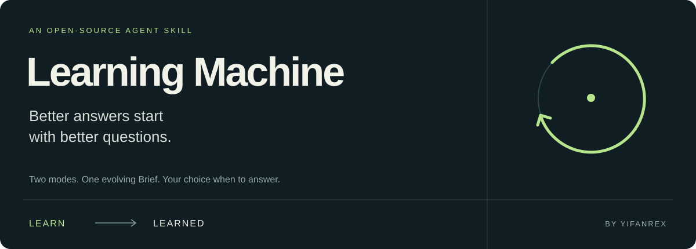

<p align="center"></p>

<p align="center">
  <a href="LICENSE">MIT licensed</a> ·
  <a href="docs/SPEC.md">Specification</a> ·
  <a href="docs/EXAMPLES.md">Examples</a> ·
  <a href="docs/INSTALL.md">Skill Install</a> ·
  <a href="README.zh-CN.md">简体中文</a>
</p>

# Learning Machine

**Explore a topic through high-leverage questions. Then answer with the context you built together.**

Learning Machine is a session-scoped context-building and reasoning tool built around **two modes** and **one working object**:
- **`Learn` Mode** — Your AI interviews you one question at a time to surface your real situation, hard constraints, goals, and beliefs, distilling them into an evolving **Session Brief**.
- **`Learned` Mode** — You switch when ready. The AI answers your questions within the topic using that **Brief** as a lens alongside its own domain knowledge and independent judgment.

It ships in **two form factors** within this repository:
1. **Web Workbench ([`workbench/`](workbench))** — A zero-dependency, split-screen local web app (conversation on the left, live interactive **Session Brief** on the right, and an explicit `LEARN / LEARNED` switch at the top).
2. **Agent Skill ([`skills/learning-machine/`](skills/learning-machine))** — A portable `SKILL.md` package for terminal and IDE agents (Devin CLI, Claude Code, Codex, Pi, and other [Agent Skills](https://agentskills.io/specification) hosts).

---

## Why It Exists

### Solving Two-Way Information Asymmetry
Useful answers depend on context you often do not think to include upfront:
- **You** hold private facts, constraints, risk tolerance, and ruled-out paths—but rarely know which of them will change the answer before seeing one.
- **The model** knows which variables matter in a domain—but lacks your private context, defaulting to generic advice written for an "average user."

Learning Machine shifts the burden of framing the problem from you to the model:
- **The topic is the boundary; your first question is just the doorway.** Exploring a side project can move naturally from a queue choice to team habits, failure tolerance, or delivery constraints.
- **Questions with leverage.** Prioritizes unknowns that affect multiple future decisions across the topic rather than running a rigid checklist.
- **Open for beliefs, grounded guesses for facts.** Subjective goals, tastes, and opinions are asked openly without anchoring options; factual details include a brief guess only when supported by prior context.
- **A lens, not a cage.** In `Learned` mode, your goals and hard constraints are respected as binding rules, while your opinions and diagnoses are evaluated critically—candidly pointing out XY problems or trade-offs when evidence disagrees.

---

## The Session Brief

Both the Web Workbench and the Agent Skill maintain the same five-section **Brief**, separating what you stated from what the model inferred:

| Section | Purpose | Update Rule |
|---|---|---|
| **01. Topic & Question** | Active topic, current mode (`Learn` / `Learned`), initial entry question, and reframed core question | Kept current as understanding evolves |
| **02. Known** | Confirmed facts, hard constraints, exclusions, goals, and explicitly attributed user beliefs (`User believes: …`) | Rewritten as new evidence arrives |
| **03. Inferences** | Unconfirmed model interpretations paired with their basis | Promoted to Known on confirmation, or removed when refuted |
| **04. Threads to Explore** | High-leverage unknowns, adjacent dimensions, and unresolved tensions | Reprioritized across turns |
| **05. Revision Log** | Append-only record (`Old understanding → New understanding`) with the basis for change | Appended whenever an assumption is overturned |

Learning is strictly **session-scoped**: starting a new topic never automatically loads or leaks context from prior sessions.

---

## Quick Start: Choose Your Form Factor

### 1. Split-Screen Web Workbench (`workbench/`)

Requires **Node.js 18+** with **zero external npm dependencies**.

```bash
git clone https://github.com/yifanRex/learning-machine.git
cd learning-machine
npm start
```

Open `http://127.0.0.1:3456` in your browser.

- **Left Column**: Clean editorial dialogue stream with an expandable input pod.
- **Right Column**: Live structured **Session Brief** cards—edit items inline, add constraints manually, confirm or reject model inferences with one click, or click any open thread to explore it.
- **Top Bar**:
  - Toggle `LEARN` / `LEARNED` state directly (switches mode state and responds in the new mode on your next message).
  - Switch model engines (`Devin CLI`, `Antigravity CLI (agy)`, or any `OpenAI-Compatible API` such as OpenAI, DeepSeek, OpenRouter, or Ollama) and select models from a dropdown.
  - Toggle Light (*White on White* linen) / Dark (*Black Square* obsidian) themes and `ZH / EN` interface language.
- **Dual Persistence**: Saves both structured session state (`.learning-machine/sessions/<id>.json`) and a standard Markdown Brief (`.learning-machine/<topic>-<date>.md`).

---

### 2. Portable Agent Skill (`skills/learning-machine/`)

Use Learning Machine directly inside your terminal or IDE coding agent. The `skills/learning-machine/` directory is isolated so skill installers copy only the pure skill files (`SKILL.md`, `agents/openai.yaml`, `LICENSE`).

#### Install via Skills CLI
```bash
npx skills add yifanRex/learning-machine --skill learning-machine
```

#### Or Install Locally (Zero Network / Python Standard Library)
```bash
git clone https://github.com/yifanRex/learning-machine.git
cd learning-machine
python3 scripts/install.py --dest ~/.agents/skills/learning-machine
```

See the [full installation guide](docs/INSTALL.md) for Claude Code (`~/.claude/skills/learning-machine`), Codex, Pi, and plain-chat usage.

#### Using the Skill in Chat
> Use learning-machine to explore my side project. Ask me questions before giving advice.

| You say | What happens |
|---|---|
| “Use learning-machine to explore…” | Enter `Learn` mode and start with one high-leverage open question |
| “answer now” / “开始回答” | Switch to `Learned` mode, show a compact Brief snapshot, and answer |
| “ask me” / “继续问我” | Return to `Learn` mode with the Brief intact |
| “Show me the Brief” | Inspect and correct the current Brief |

---

## A Short Example

**You:** I want to explore our small team's internal tool. I started by wondering whether we need a queue.

**Learn:** What would you like this tool to change about your colleagues' day?

**You:** They shouldn't have to stay late watching jobs finish. Failed work can wait until tomorrow.

**Learn:** What makes them feel they need to keep watching today?

**You:** They can't tell whether a task failed or just disappeared. Answer now: what should our first acceptance test prove?

**Learned:** Test whether someone can leave after submitting work, then account for every accepted task the next morning—including failures. Your constraint is daytime recovery, so the first test should prove visibility and recoverability, rather than assume someone will intervene overnight.

[Read a fuller multi-turn example →](docs/EXAMPLES.md)

---

## Repository Layout & Documentation

```text
learning-machine/
├── skills/learning-machine/  # Portable Agent Skill (SKILL.md, agents/openai.yaml, LICENSE)
├── workbench/                # Split-Screen Web Workbench (Node.js server + Editorial UI)
├── docs/                     # Specification, examples, installation, privacy & evaluation docs
├── evals/cases.json          # Behavioral evaluation cases
├── scripts/                  # Packaging, structural checks & local installer
├── tests/                    # Distribution and installer unit tests
└── package.json              # Root entry point (`npm start` launches the Web Workbench)
```

- [Product Specification](docs/SPEC.md) · [Examples](docs/EXAMPLES.md) · [Installation & Compatibility](docs/INSTALL.md)
- [Privacy & Session Boundaries](docs/PRIVACY.md) · [Evaluation Notes](docs/EVALUATION.md) · [ Evaluation Cases](evals/cases.json)
- [Contributing](CONTRIBUTING.md) · [Release Process](docs/RELEASE.md) · [Changelog](CHANGELOG.md)

Created by [yifanRex](https://github.com/yifanRex). Inspired by the minimalism of [Pi](https://github.com/earendil-works/pi). MIT licensed.
