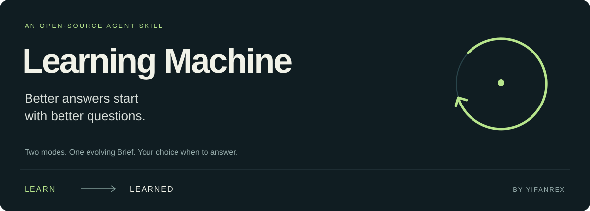

<p align="center"></p>

<p align="center">
  <a href="LICENSE">MIT licensed</a> ·
  <a href="docs/INSTALL.md">Install</a> ·
  <a href="docs/EXAMPLES.md">See it in use</a> ·
  <a href="README.zh-CN.md">简体中文</a>
</p>

# Learning Machine

**Explore a topic through better questions. Then answer with the context you built together.**

Learning Machine is a small, open-source Agent Skill. In **Learn**, your AI interviews you and keeps an evolving Brief. Say **“answer now”** to enter **Learned**: normal conversation, informed by what it has understood. Say **“ask me”** to explore again.

Two modes. One Brief. No runtime dependencies.

## Why it exists

A useful answer often depends on context you have not thought to include. Explaining all of that upfront can be harder than asking the question.

Learning Machine gives the model a simple job: find the information worth asking about, listen, revise its understanding, and use that understanding when you ask it to answer.

The topic is the boundary. Your first question is just the opening. An interview about a product can move from queues to users, delivery constraints, or how your team makes decisions.

## Try it

Install with the optional [Skills CLI](https://github.com/vercel-labs/skills), then choose your agent and installation scope:

```bash
npx skills add yifanRex/learning-machine --skill learning-machine
```

Prefer no Node.js tooling? Follow the [manual installation guide](docs/INSTALL.md).

Start a conversation:

> Use learning-machine to explore my side project. Ask me questions before giving advice.

| You say | What happens |
|---|---|
| “Use learning-machine to explore…” | Enter Learn and start with an open question |
| “answer now” / “开始回答” | Switch to Learned and answer your current request |
| “ask me” / “继续问我” | Return to Learn with the context intact |
| “Show me the Brief” | Inspect and correct the current understanding |

Clear equivalent requests work too. Mode words inside quotes, documents, or negations do not count as commands.

## A short example

*Illustrative conversation; the exact questions depend on your answers.*

**You:** I want to explore our small team's internal tool. I started by wondering whether we need a queue.

**Learn:** What would you like this tool to change about your colleagues' day?

**You:** They shouldn't have to stay late watching jobs finish. Failed work can wait until tomorrow.

**Learn:** What makes them feel they need to keep watching today?

**You:** They can't tell whether a task failed or just disappeared. Answer now: what should our first acceptance test prove?

**Learned:** Test whether someone can leave after submitting work, then account for every accepted task the next morning—including failures. Your constraint is daytime recovery, so the first test should prove visibility and recoverability, rather than assume someone will intervene overnight.

[Read a fuller example, including a correction and a return to Learn →](docs/EXAMPLES.md)

## What makes it useful

- **Questions with leverage.** Favor information that could affect several future answers within the topic.
- **Adaptive exploration.** Follow meaningful clues instead of running a fixed questionnaire.
- **An editable Brief.** Separate what you said from what the model inferred; retain the basis of corrections.
- **Your choice of mode.** The model can suggest answering, but does not switch on its own.
- **Independent judgment.** Respect your goals and constraints while remaining free to disagree with your beliefs.

The Brief holds five things: **topic and entry question, known context, inferences, open threads, and revisions**. It is updated in both modes. If files are supported, it can be a Markdown artifact; otherwise it stays in the conversation.

## Where it fits

Use it for an ambiguous topic where your circumstances matter: shaping a product, exploring a creative project, thinking through a career change, or examining a decision.

For a simple factual lookup or a task with complete instructions, direct conversation is usually cheaper. This skill adds a deliberate interview; it should earn the attention it asks from you.

## Compatibility and privacy

The core uses the [Agent Skills format](https://agentskills.io/specification). Installation paths are documented for **Codex, Claude Code, and Pi**. Other hosts can use the same skill if they support the format; plain chat can use its body as a prompt.

**Format compatibility is not a cross-platform test result.** See the [compatibility table](docs/INSTALL.md#compatibility) and [evaluation notes](docs/EVALUATION.md).

Learning is scoped to one session. A saved Brief is not automatically loaded into a new session. The skill adds no telemetry or external service, but your host still controls chat storage, files, tools, and model-provider data handling. See [privacy and context boundaries](docs/PRIVACY.md).

## Project status

**v0.1.0 — first public version.** The core was exercised in four independent, synthetic conversations comprising 13 turns in the development host. This is a small behavioral smoke test, not evidence of better outcomes or universal instruction following. Release checks cover packaging and installation separately.

Questions about interview quality remain open. Useful feedback includes unnecessary questions, missed contradictions, premature advice, and cases where the Brief did—or did not—improve the answer.

## Contribute

Start with [CONTRIBUTING.md](CONTRIBUTING.md). Share a short, redacted reproduction and the host you used. Prefer changes that fix an observed failure without adding machinery.

[Specification](docs/SPEC.md) · [Evaluation cases](evals/cases.json) · [Changelog](CHANGELOG.md) · [Release process](docs/RELEASE.md)

Created by [yifanRex](https://github.com/yifanRex). Inspired by the minimalism of [Pi](https://github.com/earendil-works/pi). Built with AI assistance. MIT licensed.
