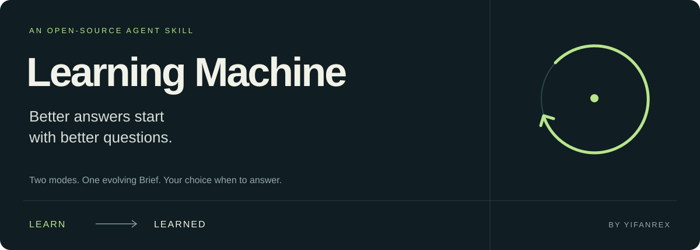

<p align="center"></p>

<p align="center">
  <a href="README.md">English</a> ·
  <a href="docs/SPEC.md">产品规格</a> ·
  <a href="docs/EXAMPLES.md">使用示例</a> ·
  <a href="docs/INSTALL.md">Skill 安装指南</a> ·
  <a href="LICENSE">MIT 许可证</a>
</p>

# Learning Machine

**通过高杠杆提问探索一个主题，再带着共同建立的上下文深度作答。**

Learning Machine 是一个以“主题（Topic）”为边界、在单次会话（Session）内对齐背景并深度推演的工具，围绕 **两种模式** 与 **一份工作对象（Brief）** 运行：
- **`Learn` 模式（默认启动）** —— AI 像一位敏锐的访谈主理人，每轮提出一个高杠杆问题，帮你理清处境、硬约束、目标与判断，并实时提炼进 **Session Brief**，在此阶段不急于下结论。
- **`Learned` 模式** —— 由你随时主动切换。AI 将 **Brief** 作为透镜（同时结合自身领域知识与独立判断）为你作答。

本仓库同时提供 **两种同源形态**，可按习惯任选其一或配合使用：
1. **分栏 Web 工作台（[`workbench/`](workbench)）** —— 零第三方依赖的本地可视化工作台：左侧为纯粹的对话流，右侧为实时演进、可直接点选交互的结构化 **Session Brief**，顶部通过 `LEARN / LEARNED` 按钮切换模式。
2. **通用 Agent Skill（[`skills/learning-machine/`](skills/learning-machine)）** —— 遵循 [Agent Skills](https://agentskills.io/specification) 标准的纯净 `SKILL.md` 插件包，可直接安装至 Devin CLI、Claude Code、Codex、Pi 等终端或 IDE Agent 中使用。

---

## 为什么做它

### 解决人与模型的“双向信息不对称”
高质量的回答往往取决于那些你一开始没想起来写进 Prompt 的背景：
- **你**掌握自己的真实处境、硬约束、风险承受力与已排除的路径，但在看到具体方案前，往往**不知道其中哪些背景会改变结论**。
- **模型**掌握领域知识（知道哪些前提一旦变化、答案就会截然不同），却**拿不到你的私有背景**，只能按“平均用户”静默脑补作答。

Learning Machine 将“把问题改写正确、把背景对齐清楚”的工作交给访谈过程：
- **以主题为边界，初始问题只是入口：** 聊一个内部工具时，可以从“要不要上队列”自然延伸到同事的工作流、故障容忍度与团队维护成本，而不必局限于最初的技术名词。
- **杠杆优先（Leverage）：** 优先追问能影响该主题下多个后续决策的底层事实与约束，拒绝固定问卷。
- **主观题开放防锚定，事实题有据才猜测：** 对动机、目标、观点和口味采用纯开放式提问，不给诱导选项；对具体事实细节仅在上下文有依据时附带简短猜测供确认。
- **Brief 是透镜，不是回音室：** 进入 `Learned` 模式后，你的目标、硬约束与口味会被当作必须遵守的前提；而你的个人观点与自我诊断会被当作待检验输入——当发现 XY 问题或风险时，模型会直率指出并给出符合硬约束的可行解。

---

## 核心工作对象：`Session Brief`

无论使用 Web 工作台还是 CLI Skill，每次会话都会维护同一份按**信息来源与确定性**严格分层的五段式 Brief：

| 模块 | 记录内容 | 更新规则 |
|---|---|---|
| **01. 主题与问题 (Topic & Question)** | 当前主题、所处模式（`Learn` / `Learned`）、初始问题、动态重述的核心待解问题 | 随认知深入实时更新 |
| **02. 已知 (Known)** | 用户明确给出的事实/处境、硬约束/排除项、目标/偏好，以及**强制带主语归因的个人观点**（如 `用户认为：……`） | 新事实覆盖旧理解，剔除无关项 |
| **03. 推测 (Inferences)** | 模型基于对话推导但尚未证实的猜测及依据 | 用户确认后升格为“已知”，被否定则移除并记入修正日志 |
| **04. 待探索线索 (Threads)** | 主题内值得横向延伸的高杠杆未知项，或用户前后说法间的张力 | 随问答推进动态重排与消解 |
| **05. 修正记录 (Revisions)** | 只追加（Append-only）：记录 `旧理解 → 新理解（原因）` | 仅当既有理解或推测被推翻时追加 |

严格遵循**单次 Session 隔离**：开启新话题时绝不自动扫描或加载历史会话的 Brief。

---

## 快速开始：任选一种形态

### 方式一：分栏 Web 工作台（`workbench/`）

仅需本机安装 **Node.js 18+**，**零第三方 npm 依赖包**，克隆后直接启动：

```bash
git clone https://github.com/yifanRex/learning-machine.git
cd learning-machine
npm start
```

在浏览器打开 `http://127.0.0.1:3456` 即可使用。

- **左栏对话画布**：去除冗余气泡框与状态横幅的编辑室排版，配备可一键展开至 66% 高度的悬浮输入舱。
- **右栏实时 Brief**：五大结构化模块，支持行内编辑、手动添加已知条件、一键「确认 / 否定」模型推测、一键带入待探索线索。
- **顶栏全局控制**：
  - `LEARN / LEARNED` 模式状态开关（点击仅切换状态，发送下一条消息时按新模式响应）。
  - 引擎与模型下拉选择：支持本机 **Devin CLI (`devin -p`)** 免 Key 直连、**Antigravity CLI (`agy -p`)**，以及任意 **OpenAI 兼容接口**（OpenAI / DeepSeek / OpenRouter / Ollama）。
  - 支持浅色（《白上之白》亚麻画布）/ 深色（《黑方块》曜石剧场）双主题切换，以及 `ZH / EN` 双语界面切换。
- **双格式落盘**：实时同步保存 `.learning-machine/sessions/<id>.json` 与标准 Markdown 格式 `.learning-machine/<主题>-<日期>.md`（顶栏点击 `MD` 可预览并复制）。

---

### 方式二：通用 Agent Skill（`skills/learning-machine/`）

纯净的 Skill 文件独立存放在 `skills/learning-machine/` 下，通过安装器安装时只会提取该目录（`SKILL.md`、`agents/openai.yaml`、`LICENSE`），不会将 Web 代码拷入你的 `.agents/skills/` 中。

#### 通过 Skills CLI 安装
```bash
npx skills add yifanRex/learning-machine --skill learning-machine
```

#### 或使用内置脚本本地安装（零网络请求，仅需 Python 标准库）
```bash
git clone https://github.com/yifanRex/learning-machine.git
cd learning-machine
python3 scripts/install.py --dest ~/.agents/skills/learning-machine
```

针对 Claude Code（`~/.claude/skills/learning-machine`）、Codex、Pi 及普通聊天窗口的详细配置，请参阅[安装指南](docs/INSTALL.md)。

#### 在 CLI 中唤起与切换
> 用 learning-machine 探索一下我的副业项目，先通过提问了解我，不急着给建议。

| 你说 | 会发生什么 |
|---|---|
| “用 learning-machine 探索……” | 进入 `Learn` 模式，从第一个高杠杆开放问题开始 |
| “开始回答” / `answer now` | 切换到 `Learned` 模式，展示精简 Brief 摘要并作答 |
| “继续问我” / `ask me` | 带着已有 Brief 回到 `Learn` 模式继续探索 |
| “看看当前 Brief” | 查看并纠正模型当前的理解 |

---

## 一小段对话示例

**你：** 我想探索我们的小团队内部工具，一开始想问要不要上队列。

**Learn：** 你希望这个工具让同事的日常工作发生什么变化？

**你：** 不用再守着等任务结束，失败可以第二天处理。

**Learn：** 现在是什么让他们觉得必须一直守着？

**你：** 分不清任务是失败了，还是直接没了。开始回答：第一版验收应该证明什么？

**Learned：** 先验证同事提交工作后能离开，第二天能对上每一个已接收任务，包括失败项。既然允许次日处理，第一版应证明状态可查、异常可恢复，而不是依赖夜间人工救场。

[阅读包含认知修正与往返切换的完整示例 →](docs/EXAMPLES.md)

---

## 仓库结构与文档导航

```text
learning-machine/
├── skills/learning-machine/  # 纯净 Agent Skill 包 (SKILL.md, agents/openai.yaml, LICENSE)
├── workbench/                # 分栏 Web 工作台 (零依赖 Node.js 服务端 + 编辑室至上主义前端)
├── docs/                     # 产品规格、完整示例、安装兼容性、隐私边界与验证文档
├── evals/cases.json          # 行为验证测试用例
├── scripts/                  # 打包构建、结构检查与本地安装脚本
├── tests/                    # 分发与安装脚本单元测试
└── package.json              # 根目录快捷启动入口 (`npm start` 启动 Web 工作台)
```

- [产品规格 (SPEC)](docs/SPEC.md) · [使用示例 (EXAMPLES)](docs/EXAMPLES.md) · [安装与兼容性 (INSTALL)](docs/INSTALL.md)
- [情境与隐私边界 (PRIVACY)](docs/PRIVACY.md) · [验证说明 (EVALUATION)](docs/EVALUATION.md) · [验证用例 (cases.json)](evals/cases.json)
- [参与贡献 (CONTRIBUTING)](CONTRIBUTING.md) · [发布流程 (RELEASE)](docs/RELEASE.md) · [版本记录 (CHANGELOG)](CHANGELOG.md)

由 [yifanRex](https://github.com/yifanRex) 创建，设计哲学受 [Pi](https://github.com/earendil-works/pi) 的极简主义启发。采用 MIT 许可证。
